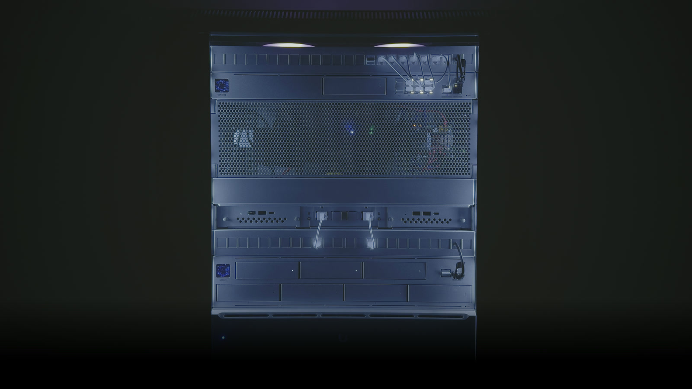

# ESPHome rack controller



ESPHome config for a QuinLED Dig-Quad (ESP32-ABE) that cools a 12U rack with two PWM fans on a PID loop and lights it per rack unit.

- Video: [Autonomous RGB Rack Cooling with ESPHome and QuinLED](https://www.youtube.com/watch?v=G8DM5r7OdXc)
- Write-up: [Autonomous RGB Rack Cooling with ESPHome and QuinLED](https://www.nightlyventures.com/p/autonomous-rgb-rack-lighting-with-esphome-and-quinled), with the parts list and wiring

Tested with ESPHome 2026.9 (September 2026), running on the device.

## Files

| File | What it does |
|---|---|
| `kage-controller.yaml` | The full config: PID fan control, fan RPM, fan ARGB that follows cooling load, a light per rack section, the *Lighting Effect* select and the *Rack Master Lights* switch. |
| `secrets.yaml.example` | The three secrets the config needs. Copy to `secrets.yaml` and fill in. |

## Usage

```bash
cp secrets.yaml.example secrets.yaml      # set the API key and your own IPs
openssl rand -base64 32                   # use this as api_encryption_key
esphome run kage-controller.yaml          # first flash over USB-C
```

Later updates go over ethernet OTA. Home Assistant asks for the API key once when it discovers the device.

The PID only controls the fans when the *Kage Cooling PID* climate entity is set to Cool. In Off mode the fans are manual.

## Things that go wrong

- `pulse_counter` already reports pulses per minute and these fans give two pulses per rotation, so the RPM filter is `multiply: 0.5`. `multiply: 30` reads 60 times too high.
- The partition lights map rack units to LED segments for my rack (one segment is about 6.2 cm, a rack unit 4.45 cm). Adjust `from`/`to` in the `partition` lights to your own layout.
- The logger stays on UART0, which shares GPIO1 and GPIO3 with the fan ARGB channels. The fan lights work with the logger enabled on this board. If you see flicker or a dead channel, set `baud_rate: 0` under `logger:` to free the pins.
- If the temperature sensor stops reporting, the fans are forced to 100% every 30 seconds.
- `neopixelbus` is deprecated on ESP32 and removal is targeted for ESPHome 2027.1. This config will move to `esp32_rmt_led_strip`.
